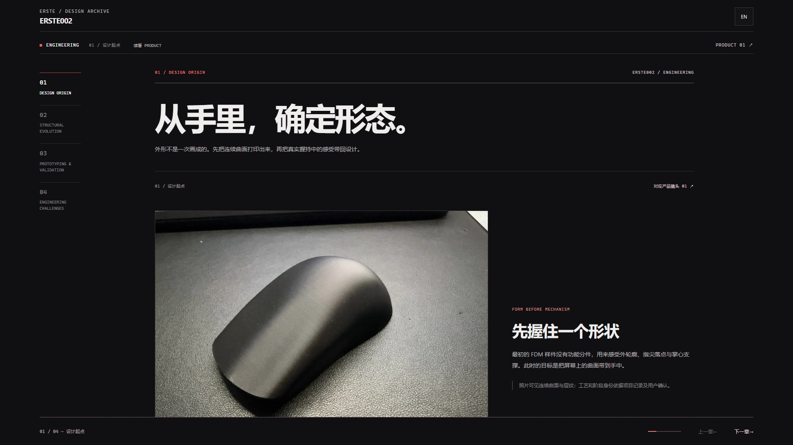
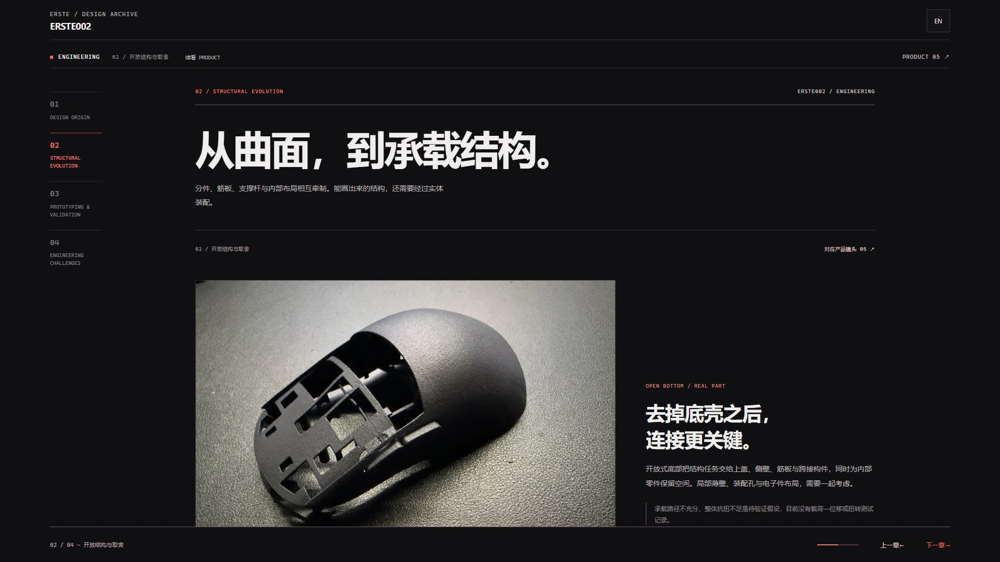
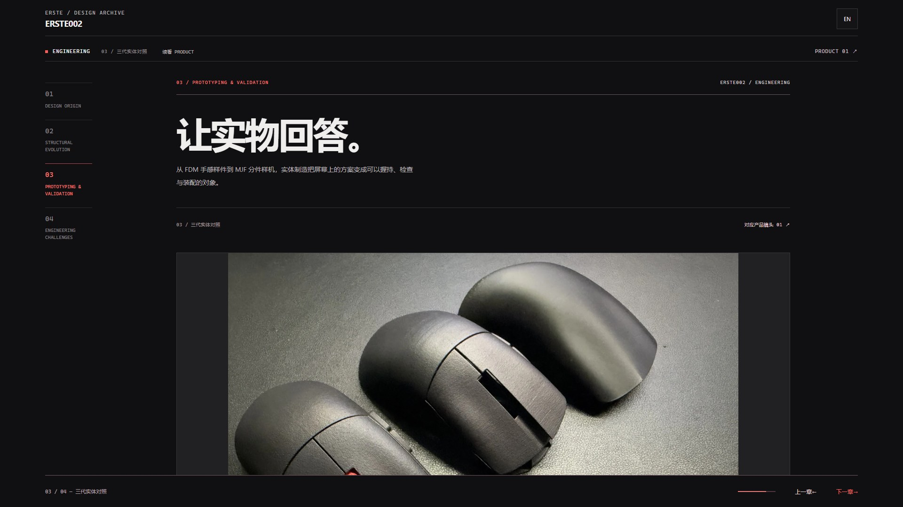
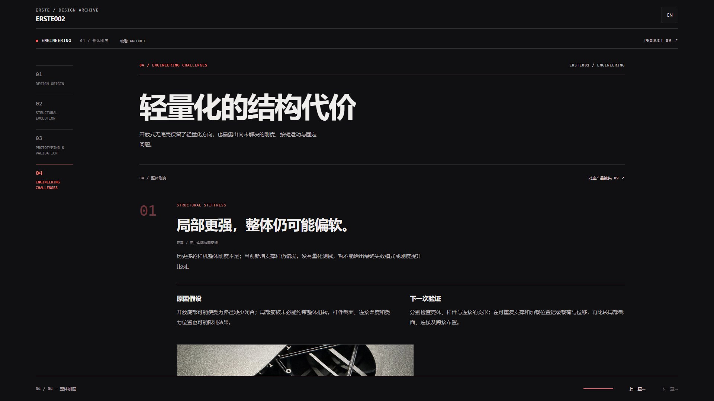

# ERSTE002 / ENGINEERING ARCHIVE · 阶段封存交接

本轮交付完整 PRODUCT / ENGINEERING 双路线。PRODUCT 保留四章 11 镜；ENGINEERING 新增四章、15 个专题、8 张入选实物照片和四个历史 STL 收件包的统一视角对照。完成后暂时暂停进一步开发，保留 CAD 修改、制造和验证入口。原有顶部统一悬浮导航、终端交互及 ERSTE001 正式内容没有在本轮修改。

## 本地访问

- 最终构建预览： http://127.0.0.1:5208/cases/erste002/index.html#engineering/overview
- 共用开场： http://127.0.0.1:5208/cases/erste002/index.html#product/01
- 终端入口： http://127.0.0.1:5208/
- 重启预览：在 D:\RhineTerminal 执行 npm run preview -- --port 5208；需要重新构建时先 npm run build。
- 不使用 /cases/erste002/ 作为 Vite 开发预览地址；明确使用 index.html，避免被 SPA fallback 解析成终端首页。

第 01 镜停留后出现 EXPLORE PRODUCT / ENGINEERING ARCHIVE。前者继续第 02 镜，后者进入工程起点。自动观看仍沿 PRODUCT 线性播放；主动进入工程会停止自动观看。顶部内容区的关联入口按当前内容跳转；“续看”单独恢复另一条路线的保存位置。位置使用当前浏览器标签页的 sessionStorage；禁用存储仍可浏览。

## 双向内容映射

统一配置：[engineering-content.js](../public/cases/erste002/engineering-content.js)。所有点击事件从同一配置读取关联目标，不维护组件内的第二套映射。

| PRODUCT 镜头 | ENGINEERING 目标 | 精确专题地址 | 该专题返回 PRODUCT |
| --- | --- | --- | --- |
| 01 | 01 / 设计起点 | #engineering/overview | 01 |
| 02 | 01 / 手感验证 | #engineering/grip | 02 |
| 03 | 01 / 外形修改 | #engineering/form | 03 |
| 04 | 01 / 实际握持 | #engineering/hold | 04 |
| 05 | 02 / 开放结构与取舍 | #engineering/open | 05 |
| 06 | 03 / 装配验证 | #engineering/assembly | 06 |
| 07 | 02 / 加强结构演进 | #engineering/reinforcement | 07 |
| 08 | 02 / 加强筋设计 | #engineering/ribs | 08 |
| 09 | 04 / 整体刚度 | #engineering/stiffness | 09 |
| 10 | 04 / 按键运动 | #engineering/buttons | 10 |
| 11 | 04 / 当前状态与阶段总结 | #engineering/status | 11 |

其他工程专题：

| 工程专题 | 精确地址 | PRODUCT |
| --- | --- | --- |
| 结构修改记录 | #engineering/history | 07 |
| 三代实体对照 | #engineering/comparison | 01 |
| 制造记录 | #engineering/fabrication | 06 |
| 电池与装配空间 | #engineering/packaging | 06 |

正常路线保持线性；跨路线跳转使用关联目标，优先于保存位置。章节目录和上/下一章对齐章节标题；专题关联入口对齐具体专题。浏览器前进后退在独立页面和终端 iframe 中均已验证。切换保留同一 canvas / WebGL 实例，11 次镜头交叉切换中模型仅请求一次。工程阅读期间停止三维渲染与自动推进。

## 四章实际截图

以下为最终本地构建的真实 Edge 截图；完整截图和机器报告见 [证据目录](erste002-engineering-evidence/)。

| 01 / DESIGN ORIGIN | 02 / STRUCTURAL EVOLUTION |
| --- | --- |
|  |  |

| 03 / PROTOTYPING & VALIDATION | 04 / ENGINEERING CHALLENGES |
| --- | --- |
|  |  |

另有 [三代实体完整对照](erste002-engineering-evidence/desktop-three-prototypes.jpg)、[CAD 包对照](erste002-engineering-evidence/desktop-cad-comparison.jpg)、[终端内桌面页面](erste002-engineering-evidence/hosted-desktop.jpg)、[触屏布局](erste002-engineering-evidence/hosted-touch-engineering.jpg) 和 [开场入口](erste002-engineering-evidence/desktop-product-opening.jpg)。

## 图片来源与版本边界

照片原件继续位于 _archive/ERSTE002/ERSTE002_Engineering_Archive/。优先核对 album.html、photo-index.json 及真实文件，未读取旧个人记忆或根据文件夹名推断版本。10 张照片逐张 SHA-256 与原索引核对，8 张入选，IMG_4239 / IMG_4243 两张备选未用于页面。

| 原件 | 内容 | 页面用途 | 优化副本 |
| --- | --- | --- | --- |
| IMG_4235.jpeg | 裸壳外侧与前部开口 | 02 开放结构 | p4235-640.webp / p4235-1536.webp |
| IMG_4236.jpeg | 内部筋板、安装柱与跨接杆 | 02 加强筋；04 刚度局部背景 | p4236-640.webp / p4236-1536.webp |
| IMG_4237.jpeg | 三件样机斜俯视对照 | 03 三代实体对照 | p4237-640.webp / p4237-1536.webp |
| IMG_4238.jpeg | 三件样机侧向对照 | 03 当前装配 | p4238-640.webp / p4238-1536.webp |
| IMG_4240.jpeg | 三件样机正面对照与确认锚点 | 04 按键边界与样件识别背景 | p4240-640.webp / p4240-1536.webp |
| IMG_4241.jpeg | 外形手感样件斜俯视 | 01 FDM 起点 | p4241-640.webp / p4241-1536.webp |
| IMG_4242.jpeg | 外形手感样件侧轮廓 | 01 侧轮廓 | p4242-640.webp / p4242-1536.webp |
| IMG_4244.jpeg | 外形手感样件俯视轮廓 | 01 俯视轮廓 | p4244-640.webp / p4244-1536.webp |

8 张照片各生成 640 / 1536 边界的 WebP 副本（实际宽高保存在清单中），保留照片比例和完整放大视图。另有 P01—P04 四张 STL 预览 WebP，共 20 个优化图片文件，合计 3,799,310 字节照片副本；包含 CAD 预览的总量为 3,929,660 字节。全部只读处理原件，不写回照片/CAD/ZIP。

逐图来源、原件 SHA-256、版本标签及副本尺寸：[engineering-assets.json](../public/cases/erste002/engineering-assets.json)。原件最终复核：[archive-integrity.json](erste002-engineering-evidence/archive-integrity.json)。可复用生成脚本：[prepare-002-engineering-assets.py](../scripts/prepare-002-engineering-assets.py)，依赖本机现有 Pillow 和原始归档。

A 为未分件 FDM 手感样件；B 为无红滚轮的第二版；C 为红滚轮当前版。IMG_4235 / IMG_4236 裸壳为当前版。这是用户确认的样件身份，不能自动对应首次 MJF / 加杆 MJF 的历史打印轮次。FDM 样件位于外形修改前还是修改后仍未细分。

历史模型来自 _archive/1.zip 至 4.zip 中的 7 个 STL。核对 ZIP 和成员哈希后复用既有统一视角预览，P01—P04 是收件包编号，不是正式 REV；模型与照片之间的映射未确认。STL 没有声明单位，不标注推测的毫米尺寸。不把中性渲染当成材料、制造或刚度证据。本批未找到可确证版本的 STEP 参数实体，因此不声称 CAD 工程往返等价。

## 验收结果

[最终浏览器报告](erste002-engineering-evidence/browser-report.json)记录 25 组通过项，测试原点为 http://127.0.0.1:5208；[开发态报告](erste002-engineering-evidence/development-browser-report.json)保留开发页面结果。

- PC：1920×1080、1440×900、1366×768。四章滚动、正常前后浏览、11 镜线性推进、15 个专题、往返切换、精确定位、历史优先级、刷新恢复、三维实例复用通过。
- 图像与语言：8 张照片和 CAD 预览实际解码；放大、上一张/下一张、方向键、Escape、焦点恢复及中英文切换通过。宿主语言消息可同步正文。
- 正常动画：自动观看从第 01 镜推进至第 02 镜；切入工程时停止。开场入口与文案避让经过截图复核。
- 异常：索引请求 503 时显示重试并可恢复；WebGL 不可用时工程仍可浏览；禁用浏览器存储仍能切换路线。
- 宿主：顶部导航避让、iframe 内浏览器前后退、图片 Escape 不误关闭项目、返回终端通过。
- 本地性能：工程入口就绪与首张实物照片完成约 278 ms，DOMContentLoaded 约 64 ms，12 个资源、3,686,866 字节传输。仅代表本机无网络限速的测试，不外推为线上或真机性能承诺。

既有回归检查与当前基线 Logo 快速审计通过，见 [checks-report.json](erste002-engineering-evidence/checks-report.json)。Logo 快速审计实际为 Chrome 桌面，不按原脚本通用结尾文字夸大为全部浏览器。默认历史 Logo 审计的旧快照仍期待旧 archive-cassette.glb 哈希，因此原始默认运行失败；当前文件在本轮前已与 HEAD 一致，本轮未更改。保留旧快照，另用本轮当前快照完成独立审计。

npm run build（TypeScript、Vite、项目运行时打包与 PWA 生成）通过。保留既有主包大于 500 kB 的构建警告，不借本轮修改终端架构。

## 移动端状态

已完成基本适配和关键功能检查：390×844、320×568、844×390，另有 390×844、DPR 2、启用触屏与 mobile 标志的 Edge 环境测试终端内入口、章节切换、图片放大及关联跳转。未进行物理手机、iOS Safari 或所有浏览器验收，不声称全平台通过。

## 工程状态与后续入口

最新样机已完成打印及装配，整体刚度、按键运动和电池固定仍需改进。无底壳造成抗扭不足是合理假设，尚无载荷—位移或扭转试验支持最终失效结论。按键不被预设为必须整体平行下移，后续检查预期轨迹、扭转、干涉、接触和限位。

另一批历史照片仍缺失；没有手握样件的照片、按压动态图像或电池固定细节。照片证明可见结构，问题报告来自设计者实际装配/按压观察，根因分析明确保持假设身份。材料牌号、重量、尺寸、载荷、位移没有可靠记录，不补造数字。

后续恢复顺序：核实历史轮次 → 修改 CAD 约束、杆件连接及电池定位 → 制造 → 重复装配与受载/按压记录 → 更新工程证据。保留全部历史原件、预览及当前测试证据。

技术债务：原三维模型仍随项目初始化，直接工程入口可进一步按需加载；原站包体和 PWA 缓存策略保持本轮基线；图片失效使用浏览器替代文本，索引层提供重试；浏览器脚本依赖本机既有 .audit/model-logo/tools 下的 Playwright，不新增生产依赖；未做广域网和真实移动设备性能测试。

## Git 与封存范围

基线提交：08dac92ee0b7b87c7ede30d051e69163e71b4060。本轮分支：development/erste002-engineering-archive，从既有 development/erste002-chapter-director 工作树创建。该基线含多处用户未提交修改，测试基于此唯一工作树完成。提交仅包含本轮工程文件及最小 PRODUCT 接入补丁；既有未提交修改继续留在工作树，不混入本轮提交。最终提交编号由交付回复和 git log 提供。

没有修改或部署 main，没有推送远端。ERSTE001、统一导航及终端源文件的既有脏状态保持，不能将“工作树仍脏”误读为本轮扩大范围。

本轮网站工程档案完成后阶段性封存；封存表示保留现状与继续开发入口，不表示实体达到全部设计目标。未来变更映射先编辑 engineering-content.js；正文与布局分别编辑 engineering-view.js / engineering.css；状态桥接集中在 engineering-app.js。
