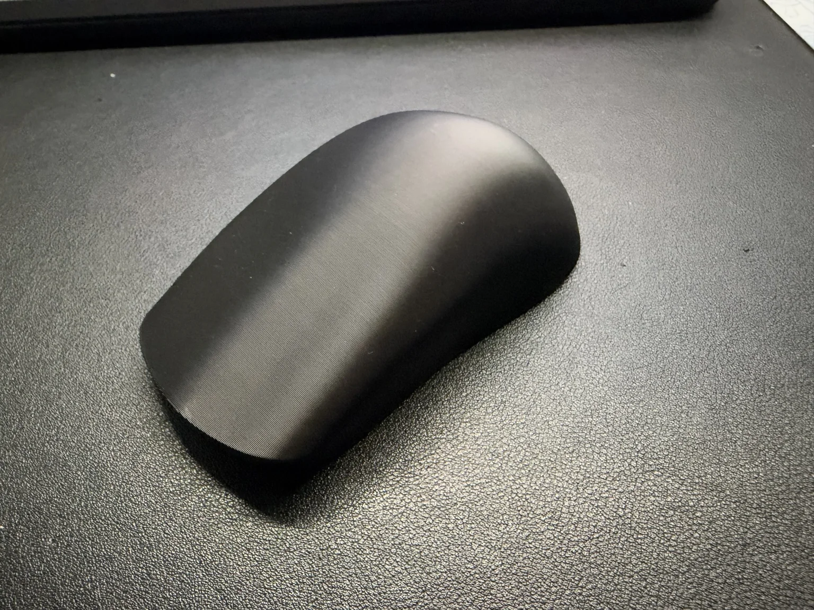
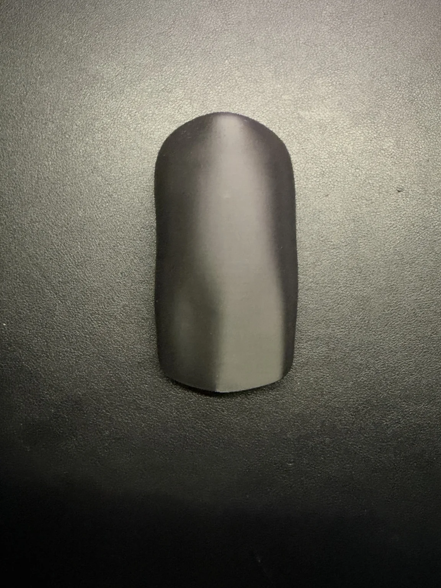
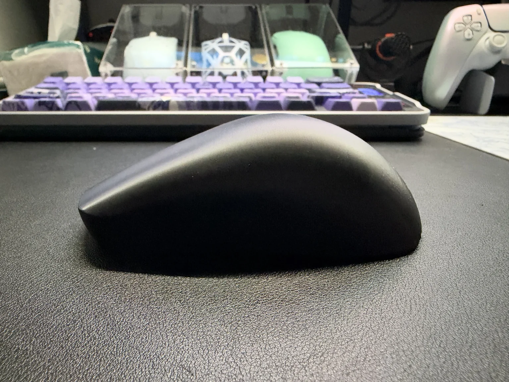
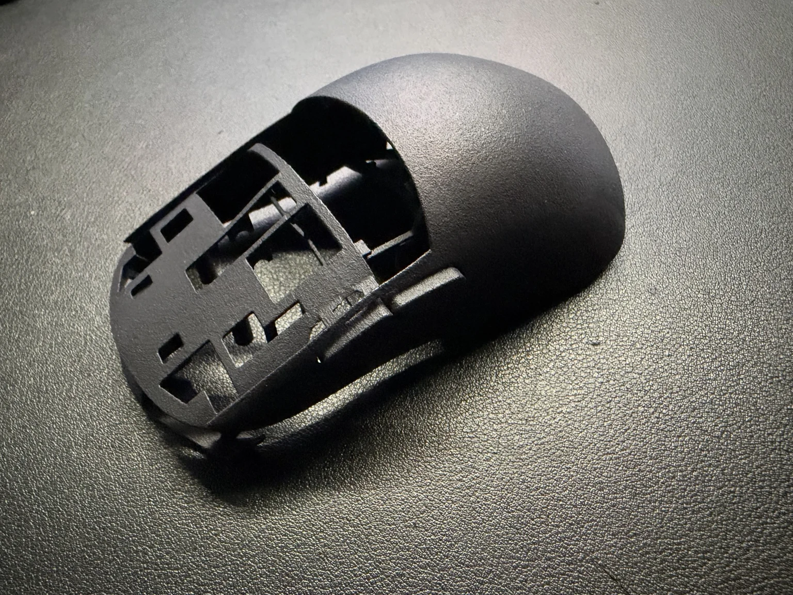
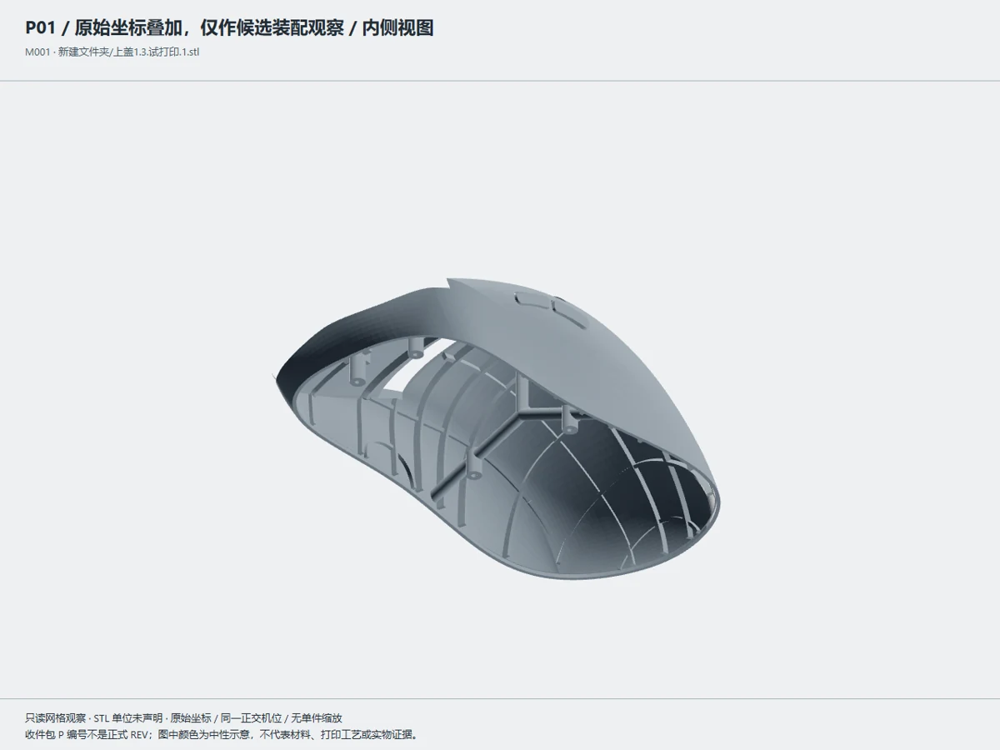
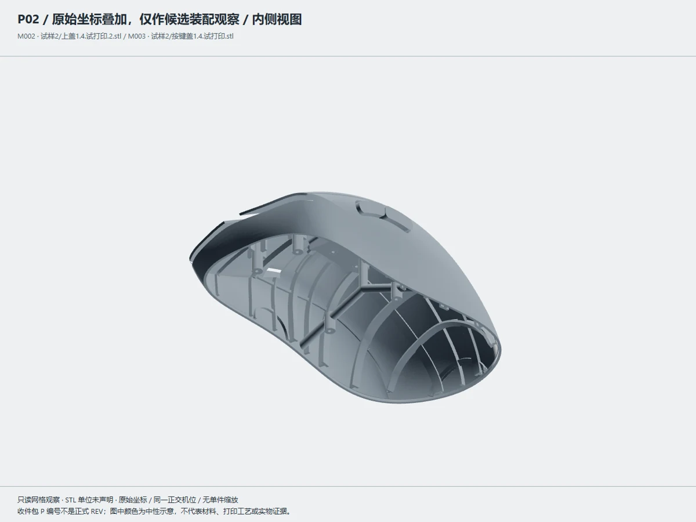
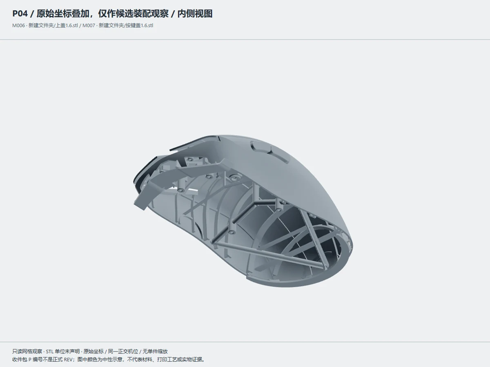
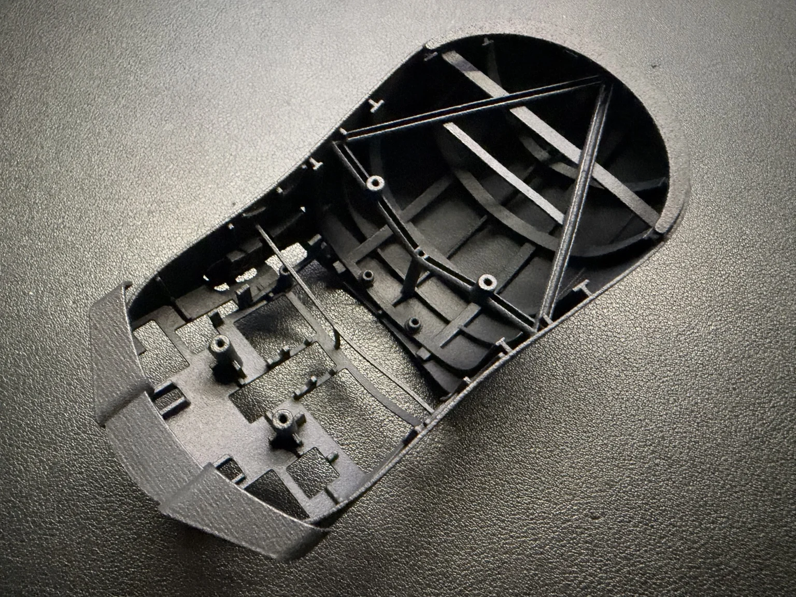
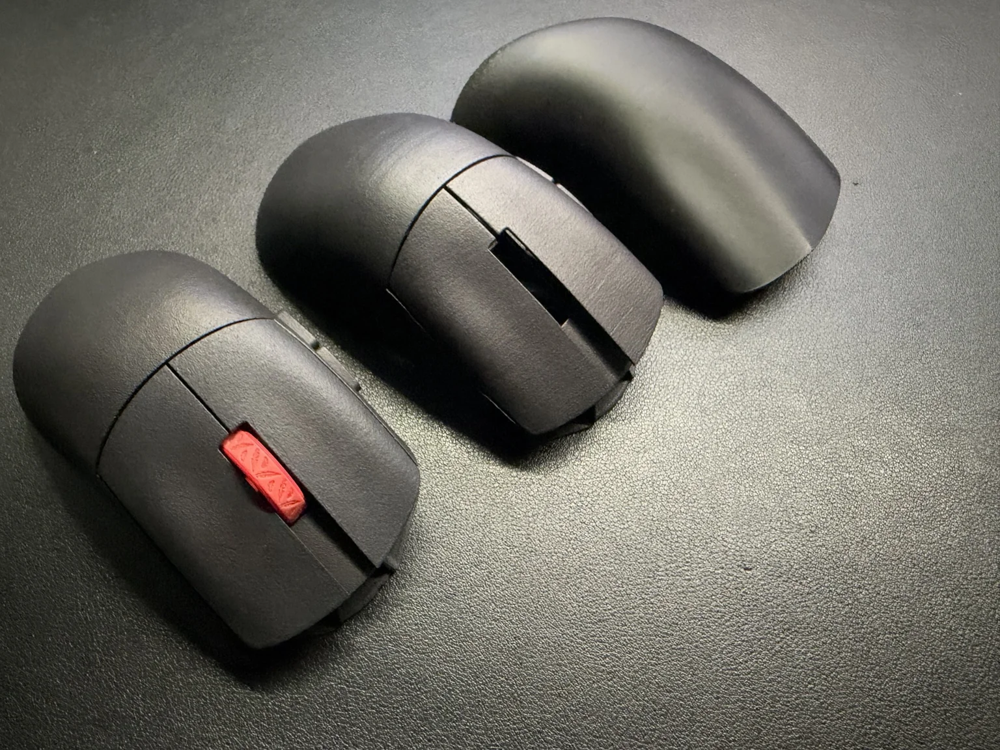
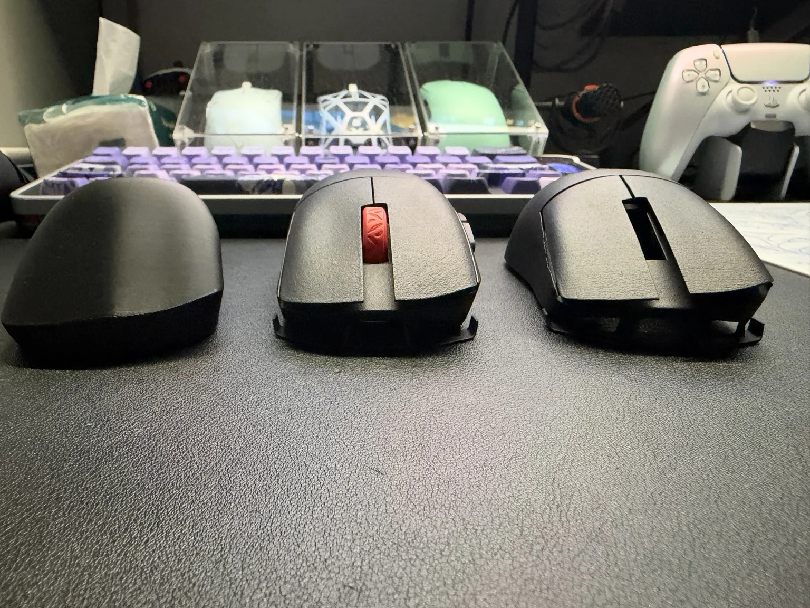

# ERSTE002 ENGINEERING｜当前结构、中文原文与图片编排

此文件由当前页面内容直接导出，保留现有措辞与顺序；不是新的文案方案。本轮只修正 PRODUCT 开场入口的动画行为，工程档案正文和图片没有改动。桌面编排为下述基准，窄屏会折叠为单栏或简化双图。

## 01 / DESIGN ORIGIN

**从手里，确定形态。**

外形不是一次画成的。先把连续曲面打印出来，再把真实握持中的感受带回设计。

### 01.1 设计起点

**编排：**左侧大幅 FDM 斜俯视照片；右侧设计说明与证据边界。

关联 PRODUCT：第 01 镜。

**IMG_4241.jpeg｜外形手感样件斜俯视**

图注原文：单个黑色外形样件 A 斜放，顶部未见按键分缝、滚轮孔和侧键；受光处可见细密平行层纹及连续曲面。

版本标注原文：FDM / 手感样件 · 改形前后未细分

*FORM BEFORE MECHANISM*

**先握住一个形状**

最初的 FDM 样件没有功能分件，用来感受外轮廓、指尖落点与掌心支撑。此时的目标是把屏幕上的曲面带到手中。

> 照片可见连续曲面与层纹；工艺和阶段身份依据项目记录及用户确认。

### 01.2 手感验证

**编排：**双栏文字：左侧手感反馈与修改，右侧反馈性质及限制。

关联 PRODUCT：第 02 镜。

**触感，成为修改的输入。**

第一次实际握持后，根据个人手感修改了一次外形。食指与中指的落点、右手两侧的高低差，逐步成为非对称设计的方向。

*设计者握持反馈 / 非人体工学实验*

这是一条实物反馈驱动的设计路径，没有受试者统计、压力分布或对照实验，不能据此宣称客观舒适度提升。

### 01.3 外形修改

**编排：**错位双图：左侧 IMG_4244 竖幅俯视；右侧 IMG_4242 横向侧视，下移 90px；下方双栏说明。

关联 PRODUCT：第 03 镜。

**IMG_4244.jpeg｜外形手感样件俯视轮廓**

图注原文：竖幅俯视照片，样件 A 沿画面长轴放置，可见整体外轮廓、连续顶部曲面与细密层纹；未见功能件分缝。

版本标注原文：FDM / 手感样件 · 改形前后未细分

**IMG_4242.jpeg｜外形手感样件侧轮廓**

图注原文：外形样件 A 的侧向照片：前部较低、后部隆起，曲面连续，侧壁向桌面延伸；未见装配电子件。

版本标注原文：FDM / 手感样件 · 改形前后未细分

**轮廓变化有记录，改形前后尚未细分。**

现存未分件样件与后续分件样机可以对照外形，但不能把手感样件直接标为改形前或改形后。照片没有统一标尺与机位，不用于计算尺寸变化。

### 01.4 实际握持

**编排：**整幅深灰文字块，左侧红色细线；没有握持照片。

关联 PRODUCT：第 04 镜。

*RIGHT-HAND ASYMMETRY*

**从连续表面，到右手的支撑关系。**

前部指位与后部掌心隆起共同定义握持轮廓。实际握持用于决定设计方向；当前产品路线展示的是后续方案的非对称曲面与掌心支撑，不是历史握持测试的影像。

> 本批照片没有手握样件的画面；不以摆拍或渲染补作测试证据。

## 02 / STRUCTURAL EVOLUTION

**从曲面，到承载结构。**

分件、筋板、支撑杆与内部布局相互牵制。能画出来的结构，还需要经过实体装配。

### 02.1 开放结构与取舍

**编排：**左侧当前裸壳大图；右侧开放式结构取舍与假设边界。

关联 PRODUCT：第 05 镜。

**IMG_4235.jpeg｜裸壳外侧与前部开口**

图注原文：单个黑色裸壳斜俯视：后部曲面连续，前部有矩形及异形开口，侧面有细长开口。画面没有按键盖、PCB、电池和滚轮。

版本标注原文：当前 MJF / 用户确认

*OPEN BOTTOM / REAL PART*

**去掉底壳之后，连接更关键。**

开放式底部把结构任务交给上盖、侧壁、筋板与跨接构件，同时为内部零件保留空间。局部薄壁、装配孔与电子件布局，需要一起考虑。

> 承载路径不充分、整体抗扭不足是待验证假设，目前没有载荷—位移或扭转测试记录。

### 02.2 结构修改记录

**编排：**H01 / H02 / NOW 三栏过程记录；下方注明历史阶段与照片版本不能直接等同。

关联 PRODUCT：第 07 镜。

*H01*

**分件 + 内部筋板**

完成分件，增加内部加强筋，进行第一次 MJF 结构验证。手感、初步刚度和装配检查发现整体刚度不足、安装孔位不准确。

*H02*

**支撑杆 + 装配调整**

增加支撑杆，调整部分装配结构，再次 MJF 打印。仍有刚度与装配干涉；曾拆除支撑杆后完成装配，但刚度仍不足。

*NOW*

**当前结构方案**

结构与装配方案再次修改，最新样机已完成打印及装配。新增杆件偏弱、按键运动和电池固定问题仍未解决。

> 历史经过依据设计者回忆；H01 / H02 是叙述阶段，不是照片版本编号。“第二版”样件不能自动归入其中某次打印。

### 02.3 加强结构演进

**编排：**顶部双栏说明；P01—P04 四个选项切换同一位置的 CAD 内侧预览；下方保留文件编号与单位限制。

关联 PRODUCT：第 07 镜。

*ARCHIVE / CAD INTAKE*

**结构差异可见，年代归属待核。**

四个历史 STL 收件包已有统一机位预览。P01—P04 仅为收件包标识，不等同于 REV 或照片样件。可比较几何形态，不据此断言制造顺序、刚度提升或实体装配结果。

**P01** · M001 / 新建文件夹/上盖1.3.试打印.1.stl

**P02** · M002 / 试样2/上盖1.4.试打印.2.stl；M003 / 试样2/按键盖1.4.试打印.stl

**P03** · M004 / 新建文件夹/上盖1.5_1.stl；M005 / 新建文件夹/按键盖1.5.stl

**P04** · M006 / 新建文件夹/上盖1.6.stl；M007 / 新建文件夹/按键盖1.6.stl

图注原文：统一内侧视角 / 原始坐标 / STL 单位未知 / 中性示意，非打印证据。

### 02.4 加强筋设计

**编排：**左侧当前裸壳内侧大图；右侧局部加强与整体刚度的区别。

关联 PRODUCT：第 08 镜。

**IMG_4236.jpeg｜内部筋板、安装柱与跨接杆**

图注原文：裸壳内侧朝上：可见多条弧形筋板、横向连接、带孔安装柱，以及跨越后部开放区的细长杆件。未装 PCB 和电池。

版本标注原文：当前 MJF / 用户确认

*LOCAL REINFORCEMENT*

**局部加筋，不等于整体闭合。**

当前裸壳照片可见弧形筋板、安装柱与跨接杆。筋板可以改变局部截面，但整体变形还取决于构件连接、自由边界与载荷施加位置。

产品第 08 镜展示当前方案的类工字形截面。它说明截面构造，不代表已有刚度测试证明。

## 03 / PROTOTYPING & VALIDATION

**让实物回答。**

从 FDM 手感样件到 MJF 分件样机，实体制造把屏幕上的方案变成可以握持、检查与装配的对象。

### 03.1 三代实体对照

**编排：**全宽三代实体照片，完整显示比例；下方三栏 A / B / C 身份说明，再接双栏版本边界说明。

关联 PRODUCT：第 01 镜。

**IMG_4237.jpeg｜三件样机斜俯视对照**

图注原文：左下为红滚轮分件样机 C，中间为空滚轮槽分件样机 B，右上为无按键分缝外形样件 A；三件在同一画面中并列。

版本标注原文：跨版本 / 用户确认

*A / FDM*

右上 · 未分件手感样件

*B / SECOND*

中间 · 第二版，空滚轮槽

*C / CURRENT*

左下 · 当前版，红滚轮

**三件实物，不是全部历史轮次。**

三代样件的身份已经确认，分件边界与外观可以直接观察。另一批历史照片暂未在本地找到，因此不声称完整覆盖每一轮制造，也不强行补齐 REV。

### 03.2 制造记录

**编排：**FDM → MJF → ASSEMBLY 三栏工艺与验证目的；没有追加照片。

关联 PRODUCT：第 06 镜。

*01 / FDM*

**外形与手感**

未分件样件。先检查外轮廓与个人握持感受。

*02 / MJF*

**分件与结构**

历次结构样件。检查刚度、孔位、零件干涉和装配关系。

*03 / ASSEMBLY*

**当前装配状态**

最新样机可完成装配；尚未完成全部验证。

> 工艺来自项目记录；材料牌号、打印参数、质量与尺寸没有可靠记录，不补写定量数据。

### 03.3 装配验证

**编排：**左侧三件样机侧向照片；右侧当前装配状态、历史干涉与证据限制。

关联 PRODUCT：第 06 镜。

**IMG_4238.jpeg｜三件样机侧向对照**

图注原文：前景为红滚轮样机 C，可见两枚侧键及侧面曲线；中景为空滚轮槽样机 B，也可见两枚侧键；后景是无分缝外形样件 A。

版本标注原文：跨版本 / 用户确认

*PHYSICAL ASSEMBLY / CURRENT*

**装得上，是验证的开始。**

前景的红滚轮样机是当前版本，已完成打印及装配。外壳、按键与侧键已形成完整外观，但这张静态照片不能证明内部所有固定与运动关系合格。

历史装配曾因 PCB 与支撑杆、侧键小板与上盖发生干涉。拆杆后装配成功的经历，说明装配可达性与刚度方案必须联合检查。

> 没有逐步装配过程照片；按“分件检查 → 装配 → 问题回报”整理记录，不以渲染替代工序证据。

## 04 / ENGINEERING CHALLENGES

**轻量化的结构代价**

开放式无底壳保留了轻量化方向，也暴露出尚未解决的刚度、按键运动与固定问题。

### 04.1 整体刚度

**编排：**左侧问题编号；右侧观察、原因假设与下一次验证。下方左侧 IMG_4236 局部裁切，右侧说明及完整照片入口。

关联 PRODUCT：第 09 镜。

*STRUCTURAL STIFFNESS*

**局部更强，整体仍可能偏软。**

*观察 / 用户实际装配反馈*

历史多轮样机整体刚度不足；当前新增支撑杆仍偏弱。没有量化测试，暂不能给出最终失效模式或刚度提升比例。

**原因假设**

开放底部可能使受力路径缺少闭合；局部筋板未必能约束整体扭转。杆件截面、连接柔度和受力位置也可能限制效果。

**下一次验证**

分别检查壳体、杆件与连接的变形；在可重复支撑和加载位置记录载荷与位移，再比较局部截面、连接及跨接布置。

图片局部使用：当前裸壳支撑杆区域。网页使用 IMG_4236 的局部裁切；[查看完整来源图](../public/cases/erste002/assets/engineering/p4236-1536.webp)。

*DETAIL / P4236*

当前裸壳内部局部：杆件、筋板与安装区域。仅为结构背景，不是受载变形照片。

### 04.2 按键运动

**编排：**问题概述 → 双栏分析与下一次验证 → IMG_4240 正面样件背景图 → 静态照片证据边界。

关联 PRODUCT：第 10 镜。

*BUTTON MECHANISM*

**运动应可控，接触应明确。**

历史问题包括按键盖与微动配合不到位、与上盖干涉，以及缺少抬起限位。最新样机按压时产生倾斜与局部翘起，偏离预期运动。

*动态问题来自用户观察 / 无动态影像*

**分析方向**

检查盖体局部扭转、连接变形、支撑位置及微动接触关系。按键不必严格平行下移；关键是符合预期轨迹，避免不可控扭转、翘起或干涉。

**下一次验证**

从不同按压位置记录轨迹与接触顺序，区分预期转动和异常变形，再调整导向、支撑及上下限位。

**IMG_4240.jpeg｜三件样机正面对照与确认锚点**

图注原文：画面从左到右依次是：无按键分缝外形样件 A、装有红滚轮的分件样机 C、滚轮槽空置的分件样机 B。B/C 的前端开口和底缘形态可对照。

版本标注原文：跨版本 / 用户确认

> 正面图用于识别样件和按键边界，不证明按压时翘起。左 A / 中 C / 右 B；不是按时间排序。

### 04.3 电池与装配空间

**编排：**文字分析；中段四步装配关系条；下方双栏空间路径与定位固定说明。没有电池细节配图。

关联 PRODUCT：第 06 镜。

*PACKAGING & ASSEMBLY*

**放得下，也要装得进、固定住。**

历史上出现 PCB 与支撑杆干涉、侧键小板与上盖干涉、孔位不准。当前电池安装困难，装好后也不牢固。

> 本批照片没有电池安装细节。问题依据实际装配反馈；以下为后续检查方向，不是已验证的根因。

*可用空间→装配路径→零件定位→保持与拆卸*

**空间与路径**

在装配顺序中检查零件扫掠空间，而不只检查最终位置；同时核对 PCB、侧键板、支撑杆与电池间的净空。

**定位与固定**

将电池的定位面与保持方式分开评估，预留接线及拆卸空间。下一轮用可重复装配检查确认方案，保留装配记录。

### 04.4 当前状态与阶段总结

**编排：**红色顶部细线、大标题、两段阶段总结、三项 OPEN 状态和重新浏览入口。

关联 PRODUCT：第 11 镜。

*PROJECT STATUS / PAUSED AFTER THIS ARCHIVE*

**可以装配。仍需改进。**

ERSTE002 已经过多轮设计迭代与实体制造验证。最新样机可以完成装配，但结构刚度、按键运动和电池固定仍需改进，尚未达到全部设计目标。

本轮网站工程档案完成后，项目暂时暂停。保留历史资料与已知问题，未来可能恢复 CAD 修改、制造和验证。

*STIFFNESS / OPEN · BUTTON MOTION / OPEN · BATTERY RETENTION / OPEN*

## 图片使用总览

| 页面顺序 | 图片 / 预览 | 使用位置 |
| --- | --- | --- |
| 1 | IMG_4241 | 01 / 设计起点 |
| 2 | IMG_4244 | 01 / 外形修改 |
| 3 | IMG_4242 | 01 / 外形修改 |
| 4 | IMG_4235 | 02 / 开放结构与取舍 |
| 5 | P01—P04 STL 内侧预览 | 02 / 加强结构演进 |
| 6 | IMG_4236 | 02 / 加强筋设计 |
| 7 | IMG_4237 | 03 / 三代实体对照 |
| 8 | IMG_4238 | 03 / 装配验证 |
| 9 | IMG_4236 局部重复使用 | 04 / 整体刚度 |
| 10 | IMG_4240 | 04 / 按键运动 |

正式使用 8 张实物照片；IMG_4239、IMG_4243 为归档备选，当前页面未使用。当前没有手握样件、逐步装配过程、按压动态图像或电池固定细节照片。
